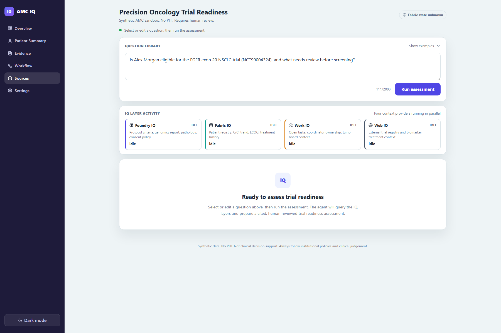
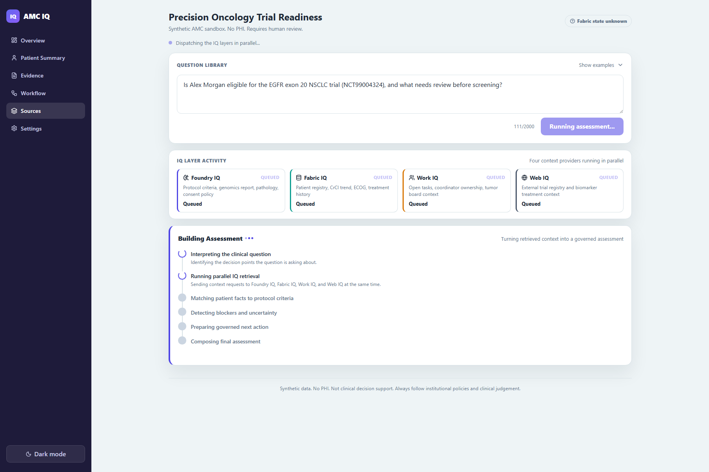
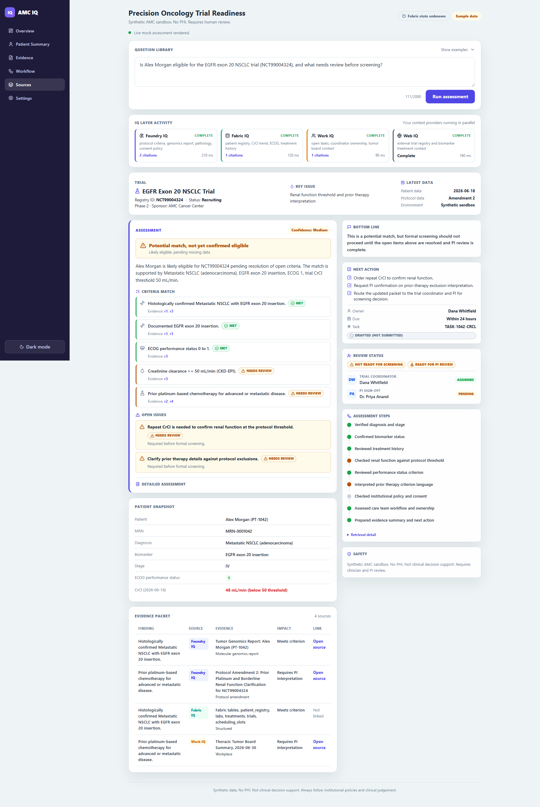

# AMC IQ: Foundry IQ Precision-Oncology Demo

> **Personal project disclaimer.** This is a personal demonstration project. It is not an
> official Microsoft product, reference architecture, clinical solution, or statement of
> Microsoft product capability.

> ⚠️ **Synthetic demonstration only. No PHI. Not clinical decision support.**
> This project does not use real patient data and is not intended for clinical decision support,
> diagnosis, treatment, trial enrollment, or patient care. All assessments require review by
> qualified clinical and research professionals. It is a demonstration of an AI architecture
> pattern, not a real clinical system.

A sandbox, executive-ready demo showing how Microsoft's **IQ intelligence layer**—
**Foundry IQ**, **Fabric IQ**, **Work IQ**, and **Web IQ**—lets a single agent reason across
patient data, clinical protocols, institutional policy, care-team workflow, and external evidence
to answer a precision-oncology **clinical-trial eligibility** question and route a safe, governed
next action to the right human.

## Scenario

> *"Patient with metastatic NSCLC, EGFR exon 20 insertion, prior platinum therapy, ECOG 1, CrCl 48.
> Open trial mentions renal thresholds and prior-therapy exclusions. Is the patient eligible, and
> what should the care team do next?"*

The agent decomposes the question, selects the right IQ sources, retrieves and merges evidence,
surfaces missing/uncertain data, and produces a recommendation routed to a human reviewer, with a
transparent retrieval and evidence trail.

## IQ source map

| Layer | Role in demo | Backing technology |
|---|---|---|
| **Foundry IQ** | Institutional knowledge (protocols, IRB/consent, notes, pathology, genomics, SOPs) | Azure AI Search agentic-retrieval knowledge base → MCP `knowledge_base_retrieve` |
| **Fabric IQ** | Structured clinical/operational data (registry, labs, treatments, trials, scheduling) | Fabric Lakehouse + Fabric Data Agent (NL2SQL via MCP) |
| **Work IQ** | Care-team workflow (tumor board, coordinator tasks, PI availability, referral queue) | Work IQ A2A v1.0 API over M365 (+ mock fallback) |
| **Web IQ** | Fresh external grounding (trial registry, labels, guideline-style evidence) | Bing-backed Azure AI Search web knowledge base (+ cached synthetic snapshots) |

## Integration truthfulness matrix

| Provider | Implementation | Data source | Auth | Default | Billable when live | Key limitation |
|---|---|---|---|---|---|---|
| Foundry IQ | **Mock** (default) / Live opt-in | Mock: `data/foundry_docs/*.md`. Live: Azure AI Search KB (`FOUNDRY_KB_NAME`) | `DefaultAzureCredential` → `search.azure.com` (`Search Index Data Reader`) | **Off** (mock) | Yes — Search units + model inference | API version `2026-05-01-preview`; live blob citations rewritten to `/api/evidence/doc` |
| Fabric IQ | **Mock** (default) / Live opt-in | Mock: `data/fabric/*.csv`. Live: Fabric Data Agent MCP endpoint | `DefaultAzureCredential` → `api.fabric.microsoft.com`; delegated-only, no service principal | **Off** (mock) | Yes — F64 capacity charges | Fabric capacity must be Active (`CapacityNotActive` if paused); delegated auth required |
| Work IQ | **Mock** (default) / Live opt-in | Mock: `data/work/` JSON + markdown. Live: `https://workiq.svc.cloud.microsoft/a2a/` (A2A v1.0 JSON-RPC) | MSAL OBO with PFX certificate from Azure Key Vault; user delegation required | **Off** (mock) | Yes — Work IQ API calls | Requires seeded M365 tenant and authenticated user; no anonymous mode; no task creation occurs |
| Web IQ | **Mock** (default) / Live opt-in | Mock: `data/web/*.json` (enforced `synthetic: true`). Live: Bing-backed AI Search KB (`WEB_KB_NAME`) | Same as Foundry IQ | **Off** (mock) | Yes — Bing queries + inference | **Web IQ product is limited-access, not GA**; this demo substitutes a Bing-backed web knowledge source (see [`docs/adr/0001-architecture.md`](docs/adr/0001-architecture.md)) |
| AI Search | Live integration (when Foundry or Web live flag on) | Azure AI Search agentic-retrieval | `DefaultAzureCredential` → `search.azure.com` | Off (mock substitutes) | Yes | Preview API; cited blob URLs are private |
| Model inference | Simulated grounded (default) / Live hosted agent (opt-in) | Default: deterministic rule-based composition. Live: Foundry Agent Service (Responses API) | `DefaultAzureCredential`; `PROJECT_ENDPOINT` + `AGENT_NAME` | **Off** | Yes — token consumption | One blocking Responses API round trip; enriches answer only; grounded adapters remain citation source |
| Task creation | **Not implemented** — drafted output only | N/A (output field) | N/A | N/A — always returns a drafted task | No | `taskStatus: 'Drafted (not submitted)'` in every response; no M365 task, Planner, or Work IQ write occurs |
| Human review | Structured output only — no routing | N/A (output field) | N/A | Always returned | No | `humanReview` carries owner/role/reason; no message or notification is sent automatically |
| Citations | Mock: local files via `/api/evidence/doc`; Live: AI Search refs rewritten to same | `data/foundry_docs/` and `data/work/` | `/api/evidence/doc` is public, allowlisted, traversal-guarded | Always returned | No | Live Foundry blob URLs are firewalled; adapter rewrites to local docs |
| External web retrieval | Mock: cached JSON fixtures; Live: Bing-backed KB | Mock: `data/web/clinicaltrials_NCT99004324.json`; Live: Bing via AI Search | Same as AI Search | **Off** (mock) | Yes when live | Mock enforces `synthetic: true`; live returns real web content |

## Architecture

```
React/Vite exec UI  ──REST + SSE──▶  FastAPI backend  ──▶  Hosted Foundry Agent (opt-in)
                                          │
                                ┌─────────┼──────────────────┐
                                ▼         ▼                  ▼
                          Foundry IQ  Fabric IQ         Work IQ / Web IQ
                      (Azure AI Search  (Fabric Data        (Work IQ A2A /
                         KB, MCP)       Agent, MCP)      Bing KB + mock)
```

The backend dispatches all four IQ layers concurrently. Eligibility evaluation starts as soon as
the Fabric result is available, overlapping with slower sources. See
[`docs/backend.md`](docs/backend.md) for the full orchestration lifecycle.

## Screenshots

| | |
|---|---|
|  | Select a scenario question, edit it, and watch the four IQ context providers retrieve evidence in parallel. |
|  | The interface separates source retrieval from the auditable workflow used to build the assessment. |
|  | The completed assessment turns distributed clinical, institutional, workflow, and public context into a cited recommendation for human review. |

## Prerequisites

| Tool | Required for | Minimum version |
|---|---|---|
| Python | Backend | 3.12 |
| Node.js | Frontend | 22 |
| npm | Frontend | bundled with Node 22 |
| PowerShell | `scripts/dev.ps1` launcher | 7+ (or Windows PowerShell 5.1) |
| Azure CLI (`az`) | Live provisioning only | latest |
| Azure Developer CLI (`azd`) | Cloud deployment only | latest |

No Azure account is needed for the local mock walkthrough.

## Run the demo (local, no cloud)

The demo runs fully offline in **deterministic mock mode** against the synthetic `data/` package—
no Azure, no auth. One command:

```powershell
./scripts/dev.ps1
```

This starts the FastAPI backend on `http://localhost:8000` and the Vite dev server on
`http://localhost:5173`. Open the UI and click **Ask** on the pre-filled oncology question.

Manual alternative:

```powershell
# Backend
python -m venv .venv; .\.venv\Scripts\python -m pip install -r services/api/requirements.lock.txt
$env:APP_ENVIRONMENT="development"
$env:USE_LIVE_FOUNDRY=$env:USE_LIVE_FABRIC=$env:USE_LIVE_WORK="false"
$env:USE_LIVE_WEB=$env:USE_LIVE_AGENT=$env:USE_LIVE_SPECIALISTS="false"
Push-Location services/api
..\..\.venv\Scripts\python -m uvicorn app.main:app --port 8000
Pop-Location

# Frontend (new terminal)
cd apps/web; npm ci; npm run dev
```

Validate data and run tests:

```powershell
.\.venv\Scripts\python tools/validate_consistency.py     # synthetic data consistency
cd services/api; ..\..\.venv\Scripts\python -m pytest    # backend tests
cd apps/web; npm test                                     # frontend tests
```

## Data cohort, ontology & multi-agent

Beyond the hero thread, the demo ships a deterministic synthetic **cohort** (25 patients, 10 trials,
16 Fabric tables) and an **ontology** (typed entities + relationships) so eligibility is a
relationship traversal, not ad hoc SQL. A **multi-agent** specialist team (eligibility, renal/labs,
genomics, protocol, workflow, evidence) runs in parallel and deepens its investigation as it
discovers leads, reconciled by a synthesizer/critic against the ontology as ground truth.

- Regenerate the cohort (idempotent): `.\.venv\Scripts\python data/fabric/generate.py`
- The multi-agent team is **off by default**; enable it with `USE_MULTI_AGENT=true`
  (optionally `AGENT_MAX_DEPTH`, `AGENT_MAX_LEADS`). It drives the UI **Assessment Steps** trace.

Full details are in [`docs/ontology-and-multi-agent.md`](docs/ontology-and-multi-agent.md).

## Go live (real Foundry / Fabric / Work IQ / Web IQ)

To opt into live services, supply your own subscription, resource groups, service names, workspace,
and app registrations. The provisioning scripts have no owner-environment defaults:

```powershell
az login --use-device-code
Get-Help ./agent/provisioning/live/provision_all.ps1 -Full
# Invoke it only after supplying every Mandatory parameter.
```

Then set the required live flags and coordinates from `services/api/.env.example`. `scripts/dev.ps1`
always forces safe mock mode; use explicit manual backend/frontend processes for live testing. Full
prerequisites and safeguards are in [`agent/provisioning/live/README.md`](agent/provisioning/live/README.md)
and each script's `Get-Help` output. See [`docs/deployment.md`](docs/deployment.md) for the full
deployment guide and teardown steps.

## Cost considerations

All live IQ providers can incur Azure charges. The demo is designed to be cost-safe by default:
mock mode is free and requires no cloud account. When live providers are enabled:

| Component | Cost driver |
|---|---|
| Azure AI Search | Search units (provisioned) + agentic-retrieval inference tokens |
| Foundry Agent Service | Model inference tokens per assessment |
| Fabric F64 capacity | Per-second charges when Active; **suspend the capacity when not demoing** |
| Work IQ | API call charges (when GA and live); Key Vault reads |
| Bing-backed web KB | Bing search transactions |

**To minimize cost:** use `scripts/dev.ps1` for demos (forces mock mode). Suspend the Fabric capacity
after provisioning (`az fabric capacity suspend`). Set `USE_LIVE_FABRIC=false` unless testing the
live Fabric path. Review the teardown steps in [`docs/deployment.md`](docs/deployment.md) when done.

## Security

This demo handles synthetic data only. For the security model, threat boundaries, and
vulnerability reporting, see [`SECURITY.md`](SECURITY.md) and [`docs/security.md`](docs/security.md).
In brief:

- All assessment and cohort routes require a delegated bearer token in non-mock mode.
- Mock mode is allowed only when `APP_ENVIRONMENT=development` and every live flag is `false`.
- Work IQ uses MSAL OBO with a Key Vault-backed certificate; no credential is committed to source.
- `/api/evidence/doc` is public but allowlisted to synthetic `data/foundry_docs/` and `data/work/`
  files only, with traversal protection.
- No task creation, no M365 write operations, and no patient data is stored.

## Known limitations

See [`docs/limitations.md`](docs/limitations.md) for the full list. Key items:

- Web IQ is a Bing-backed Azure AI Search stand-in; the native Web IQ product is limited-access.
- Fabric and Work IQ require delegated/OBO identity; no service-principal path exists.
- The hosted Foundry agent is optional; the grounded deterministic path runs without it.
- Task drafting is output only — no write to M365 or Work IQ occurs.
- Trial IDs use a `NCT99xxxxxx` demo range; all returned HTTP 404 on ClinicalTrials.gov on
  2026-07-25 (recheck immediately before publication).
- The `2026-05-01-preview` AI Search API version may change.

## Documentation

| Doc | Purpose |
|---|---|
| [`docs/architecture.md`](docs/architecture.md) | Architecture overview and IQ layer decisions |
| [`docs/backend.md`](docs/backend.md) | FastAPI stack, orchestration lifecycle, endpoints, mock/live, testing |
| [`docs/frontend.md`](docs/frontend.md) | React/Vite structure, components, state, SSE, rendering |
| [`docs/data-model.md`](docs/data-model.md) | Fabric Lakehouse schema, ontology, eligibility traversal |
| [`docs/synthetic-data.md`](docs/synthetic-data.md) | Authorship, generation, reset, safety, fictional ID guarantee |
| [`docs/configuration.md`](docs/configuration.md) | All environment variables, flag routing matrix, mock gate |
| [`docs/deployment.md`](docs/deployment.md) | azd/IaC, provisioning scripts, teardown, cost warnings |
| [`docs/security.md`](docs/security.md) | Auth boundaries, threat model, prompt injection, citation trust |
| [`docs/troubleshooting.md`](docs/troubleshooting.md) | Common failures and fixes |
| [`docs/limitations.md`](docs/limitations.md) | Explicit scope and known limitations |
| [`docs/ontology-and-multi-agent.md`](docs/ontology-and-multi-agent.md) | Synthetic cohort, ontology + traversal, multi-agent specialist team |
| [`docs/api-contract.md`](docs/api-contract.md) | Backend and frontend integration contract |
| [`docs/adr/0001-architecture.md`](docs/adr/0001-architecture.md) | Architecture decision record |
| [`docs/adr/0002-work-iq-authentication.md`](docs/adr/0002-work-iq-authentication.md) | Delegated Work IQ authentication boundary |
| [`docs/naming-conventions.md`](docs/naming-conventions.md) | Naming, tagging, and consistency standard |
| [`data/registry/README.md`](data/registry/README.md) | Canonical demo-entity registry |

## Repository layout

| Path | Contents |
|---|---|
| `agent/` | Hosted Foundry agent instructions and live provisioning scripts |
| `services/api/` | Python FastAPI backend (orchestrator, IQ adapters, streaming, auth) |
| `apps/web/` | React, Vite, TypeScript executive demo UI |
| `data/` | Synthetic data package; `data/registry/` is the canonical demo-entity registry |
| `infra/` | azd and Bicep IaC for the live Azure-hosted application |
| `docs/` | Public architecture, API contract, ADRs, and conventions |
| `tools/` | Synthetic data consistency validator |
| `scripts/` | Local dev launcher (`dev.ps1`) and probes |

## License

Licensed under the [MIT License](LICENSE). Dependency and service terms remain governed by their
respective upstream licenses and agreements.

## Status

The public release candidate is mock-first and runs locally without cloud credentials. Live Foundry,
Fabric, Web, and Work IQ integrations are optional and require operator-provided Azure/Microsoft 365
resources. No private deployment coordinates or live-environment status are included in this
repository.
